# AI-Based Structural Variant Detection Using Long-Read Sequencing Data

**Course:** DNA Sequencing Technologies (22AIE455) · **Type:** Bioinformatics + Machine Learning + Explainable AI

A reproducible Snakemake pipeline that takes human long-read sequencing data from raw reads
to a scored structural-variant (SV) callset. It aligns Oxford Nanopore and PacBio HiFi reads
to GRCh38 with Minimap2, proposes candidate SVs with Sniffles2 and cuteSV, extracts 33
evidence features per candidate, and trains Random Forest and XGBoost classifiers to separate
real SVs from artefacts. The models are benchmarked against the GIAB HG002 truth set and
against the callers themselves, explained with SHAP, and summarised in an HTML/PDF report and
an interactive demo site.

The ML layer **does not replace** Minimap2, Sniffles2 or cuteSV. It scores and filters the
candidates they produce, so it can only ever recover SVs that at least one caller proposed.

---

## Contents

1. [At a glance](#at-a-glance)
2. [Research question](#research-question)
3. [The ground-truth problem and the two-stage design](#the-ground-truth-problem-and-the-two-stage-design)
4. [Data](#data)
5. [Pipeline](#pipeline)
6. [Features](#features)
7. [Labelling](#labelling)
8. [Models](#models)
9. [Evaluation protocol](#evaluation-protocol)
10. [Results](#results)
11. [Outputs produced](#outputs-produced)
12. [Demo site](#demo-site)
13. [Repository layout](#repository-layout)
14. [Running the pipeline](#running-the-pipeline)
15. [Issues found by running on real data](#issues-found-by-running-on-real-data)
16. [Limitations](#limitations)
17. [Outstanding work](#outstanding-work)
18. [Documentation](#documentation)
19. [Course alignment](#course-alignment)
20. [References](#references)

---

## At a glance

| | |
|---|---|
| Architecture | **Complete**. Reviewed against verified GIAB sources; see [docs/](docs/) |
| Implementation | **Complete**. 12 Snakemake rule files, the `svml` Python package, 87 unit tests passing, `ruff` clean |
| Execution | **Complete for the Tier-1 pilot**. All stages ran end to end on real GIAB data under WSL2 |
| Results | **Measured** on held-out chr22 windows; nothing in this README is illustrative |
| Outstanding | Manual IGV curation of errors, a fresh-clone reproducibility check, the Tier-2 scaling decision |

**Headline results (held-out chr22 test windows, HG002 ONT):**

| Question | Answer |
|---|---|
| Does the ML filter beat the best simple heuristic? | **Yes, narrowly.** At the same recall as "keep only calls both callers agree on" (0.633), precision rises from 0.836 to 0.840 (RF, +0.47 pp) and 0.840 (XGBoost, +0.39 pp) |
| Random Forest or XGBoost? | **No significant difference.** F1 difference 95% CI [−0.012, +0.045] spans zero |
| Does the gain concentrate in repetitive regions? | **Not supported** for the headline RF model (+0.044 low-repeat vs +0.039 high-repeat). XGBoost points the other way (−0.002 vs +0.099) |
| How much can any filter recover? | **Recall is capped at 0.683.** 89 of 281 real SVs were proposed by neither caller |
| Does the model need the callers' own scores? | **Yes.** Using only read and annotation evidence, precision drops below the both-callers baseline |
| DEL vs INS typing (Stage B) | Macro-F1 1.000 for both models, on 192 test candidates |
| Five-class typing (Stage C, pseudo-labels) | RF macro-F1 0.397, measured against caller consensus, **not** GIAB truth |

---

## Research question

Long-read SV callers such as Sniffles2 and cuteSV have high sensitivity but produce many false
positives, especially in repetitive and low-mappability regions. The project asks:

> Can a supervised classifier trained on alignment, sequence-context and caller evidence
> improve the precision of long-read SV calling over the callers and their simple
> combinations, and is that improvement larger in repetitive regions?

Objectives as delivered:

| | Objective | Status |
|---|---|---|
| O1 | Reproducible FASTQ → BAM → candidate pipeline | Done for three samples |
| O2 | ≥ 15 engineered features per candidate | 33 features in 4 groups |
| O3 | Classifier benchmarked against GIAB | Restated as Stage A + Stage B (see below); both benchmarked |
| O4 | Comparison against heuristic callers | Six baselines, matched-recall comparison, bootstrap CIs |
| O5 | Explainability | SHAP global, dependence and per-candidate explanations |
| O6 | Report | 20-section HTML/PDF report, summary JSON, demo site |

---

## The ground-truth problem and the two-stage design

The architecture review ([docs/00_architecture_evaluation.md](docs/00_architecture_evaluation.md))
found one **blocking** issue: **no GIAB truth set labels DUP, INV or TRA.** Verified against the
live GIAB release tree:

- `NIST_SV_v0.6` is GRCh37 only, and its README states *"All now are DEL or INS"*.
- `v5.0q stvar` is GRCh38-native but assembly-derived, and its benchmark regions exclude
  inversion interiors.
- `NISTv4.2.1` covers small variants (SNVs/indels), **not** SVs. The original specification
  cited it as SV ground truth; that was an error.

A five-class classifier benchmarked against GIAB at macro-F1 ≥ 0.85 therefore cannot be built
as specified: the labels do not exist. The project was restructured into three stages:

| Stage | Task | Labels | Benchmarked? |
|---|---|---|---|
| **A** | Candidate validity: real SV or artefact | GIAB v5.0q | **Yes, primary** |
| **B** | SV type: DEL vs INS | GIAB v5.0q | **Yes, secondary** |
| **C** | Five-class INS/DEL/DUP/INV/TRA | Caller-consensus pseudo-labels | **No, exploratory** |

Stage A is also the task that answers the research question, which is about precision rather
than type. Decisions taken as a result:

1. **O3 restated.** The macro-F1 target applies to Stages A and B; Stage C ships as an
   exploratory result clearly labelled as pseudo-labelled.
2. **Truth set** switched to GIAB `v5.0q stvar` on GRCh38, keeping the mandated reference build.
3. **Scope** reduced to pilot windows on selected chromosomes rather than the whole genome.

---

## Data

### Samples

All reads are fetched region-sliced from GIAB's public pre-aligned BAMs via HTTP range
requests, converted back to FASTQ, and re-aligned, so the genuine FASTQ → Minimap2 → BAM path
runs without downloading whole genomes.

| Sample | Platform | Role | Reads | Bases | Read N50 | Median Q | Mapping rate | Merged candidates |
|---|---|---|---|---|---|---|---|---|
| HG002 | ONT ultra-long | **Labelled**: train / validation / test | 115,137 | 2.03 Gb | 52.7 kb | 10.6 | 99.96% | 1,366 |
| HG002 | PacBio HiFi (Sequel II) | Generalisation: same truth, different error profile | 35,290 | 0.50 Gb | 13.5 kb | 31.8 | 100.0% | 244 |
| HG005 | ONT ultra-long | Unlabelled: pipeline robustness only (no SV truth released) | 9,665 | 0.27 Gb | 49.3 kb | 12.0 | 99.97% | 165 |

QC thresholds (min length 1 kb, min mean Q7) are recorded, not applied: Minimap2 handles short
and low-quality reads, and filtering before alignment would change the read population the
features describe.

### Reference, truth and annotations

| Asset | Source |
|---|---|
| Reference | GRCh38 no-alt analysis set (GCA_000001405.15). ALT contigs are excluded because they fragment long-read alignments and create spurious SV signatures |
| Truth | GIAB HG002 `v5.0q stvar` GRCh38 VCF plus its benchmark BED of confident regions (md5-verified) |
| Annotations | UCSC hg38 `simpleRepeat`, `rmsk`, `genomicSuperDups` and `gap` tracks |

### Regions and splits

Only one sample has SV truth, so a sample-level split is impossible. The split is
**chromosome-grouped**, so no genomic locus can appear in two splits:

- Full design (Tier 2): train chr1–16, validate chr17–19, test chr20–22 + chrX.
- Executed pilot (Tier 1): windows chosen from the truth set for SV density and
  confident-region coverage, sized to fit a ~4 GB download.

| Window | Split | Approx. truth SVs | Confident coverage |
|---|---|---|---|
| chr16:1–15,000,000 | train | ~334 | ~97% |
| chr16:85,000,001–90,000,000 | train | ~299 | ~98% |
| chr19:1–10,000,000 | validation | ~391 | ~96% |
| chr22:40,000,001–50,000,000 | **test** | ~300 | ~100% |

The HiFi sample uses the chr22 test window only, and HG005 uses chr22:45–50 Mb. Candidates within
20 kb of a window edge are dropped, because sliced coverage tapers there and biases depth
features. These are SV-rich sub-telomeric windows, so **pilot metrics are not
genome-representative**.

---

## Pipeline

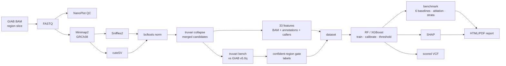

| Stage | Rule file | Tools (versions as run) |
|---|---|---|
| References | `00_references.smk` | curl, samtools, minimap2 multi-part index, md5 verification |
| Acquisition | `01_acquire.smk` | samtools (HTTP range slicing), `samtools fastq` |
| QC | `02_qc.smk` | NanoPlot 1.42.0 |
| Alignment | `03_align.smk` | minimap2 2.28 (`map-ont` / `map-hifi`), samtools 1.20 |
| SV calling | `04_call.smk` | Sniffles 2.6.2, cuteSV 2.1.4, bcftools 1.20 normalisation |
| Merge | `05_merge.smk` | truvari 4.3.1 `collapse` |
| Features | `06_features.smk` | `svml features` (pysam 0.22.1), six sanity gates |
| Labels | `07_labels.smk` | truvari `bench`, confident-region gate |
| Training | `08_train.smk` | scikit-learn 1.5.2, XGBoost 2.1.4, split-leakage check |
| Benchmark | `09_benchmark.smk` | `svml benchmark`, ablation, error analysis, final VCF |
| Explainability | `10_explain.smk` | SHAP 0.46.0 |
| Report | `11_report.smk` | Jinja2 HTML, PDF, provenance metadata |

Environment: Python 3.11, Snakemake 8.30, one micromamba environment (`svml`) under WSL2. Every
run writes `run_metadata.json` with tool and package versions, the config digest, random seed
(42), reference build, truth set and split map.

---

## Features

33 features in four groups, defined once in
[`src/svml/features/registry.py`](src/svml/features/registry.py); the
[feature dictionary](docs/03_feature_dictionary.md) is generated from it. Structurally
undefined values (for example a depth ratio for an insertion, or a caller's support when that
caller did not call the SV) are left missing with an indicator column, never filled with a
guessed default.

| Group | Source | Features |
|---|---|---|
| **B**: read evidence (15) | BAM, independent of the callers | `dp_local`, `dp_flank_ratio`, `dp_mad_local`, `mean_mapq`, `median_mapq`, `frac_mapq0`, `n_split_reads`, `n_clipped_reads`, `clip_frac`, `n_spanning_reads`, `support_ratio`, `strand_balance`, `mean_read_len_local`, `mean_nm_rate`, `n_supplementary` |
| **A**: genomic context (8) | Reference + UCSC annotations | `tr_overlap_frac`, `rmsk_overlap_frac`, `segdup_overlap`, `dist_to_nearest_gap`, `gc_content`, `homopolymer_len_at_bp`, `bp_microhomology_len`, `chrom_class` |
| **C**: caller evidence (7) | Sniffles2 / cuteSV records | `sniffles_support`, `cutesv_support`, `n_callers`, `bp_offset_between_callers`, `svlen_disagreement`, `caller_qual`, `filter_pass` |
| **V**: caller-declared (3) | Caller output | `log10_svlen`, `svtype_called`, `span_len` |

Groups B + A (23 features) are the **independent-evidence** set used for the ablation.
`svtype_called` is always withheld from Stage B, and `log10_svlen` uses |SVLEN| so its sign
cannot leak the DEL/INS label.

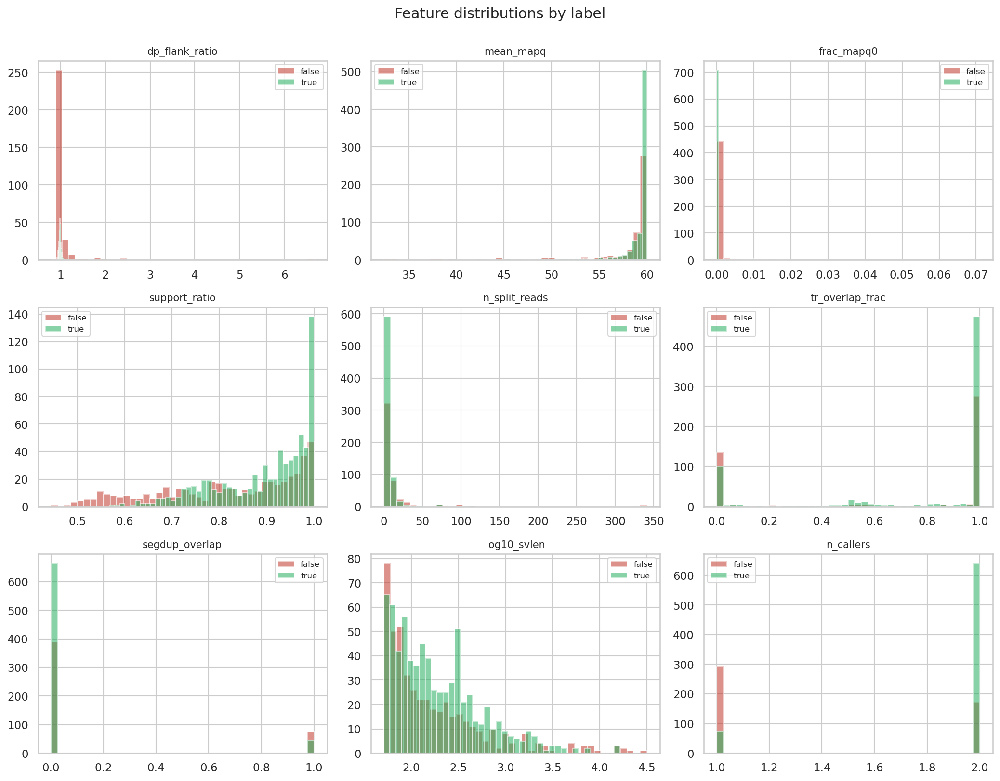

---

## Labelling

- Candidates are matched to GIAB v5.0q with `truvari bench`, using the same parameters for
  labelling and for evaluation (enforced by config validation): `refdist 500`, `pctsize 0.7`,
  `pctseq 0`, `pctovl 0`, `sizemin 50`, `passonly false`, `refine off`.
- `pctseq` is 0 because both callers emit symbolic alleles (`<DEL>`); with sequence similarity
  required, truvari silently drops them and almost nothing would be labelled.
- **Confident-region gate.** A candidate with no truth match counts as false only if it lies
  inside GIAB's confident regions. Outside them it is left unlabelled, not negative, since the
  benchmark makes no claim there. Labelling those as false would teach the model that real SVs
  in hard regions are artefacts.

HG002 ONT outcome: 1,366 candidates, of which 1,252 (91.7%) fall inside confident regions:
**713 true**, **466 false**, and **114 unlabelled** outside confident regions. Across the
windows, 459 truth SVs were proposed by neither caller (chr16 241, chr19 129, chr22 89).

| Split | True | False | Total labelled |
|---|---|---|---|
| Train (chr16) | 326 | 210 | 536 |
| Validation (chr19) | 195 | 167 | 362 |
| Test (chr22) | 192 | 89 | 281 |

Stage C pseudo-labels come from caller consensus: the declared type where Sniffles2 and cuteSV
agree.

---

## Models

Ten trained models, each saved with its fitted encoder and a JSON metadata file:

| Model | Classes | Inputs | Val score | Threshold | Hyperparameters (selected on validation) |
|---|---|---|---|---|---|
| **Stage A, Random Forest, all features** (headline) | 2 | 33 | F1 0.844 | 0.39 | 200 trees, max depth 20, min leaf 8, `log2` features, balanced class weights |
| Stage A, XGBoost, all features | 2 | 33 | F1 0.839 | 0.49 | 200 trees, depth 10, learning rate 0.01 |
| Stage A, Random Forest, B+A only | 2 | 23 | F1 0.694 | 0.52 | 200 trees, depth 8, min leaf 8, `sqrt` features |
| Stage A, XGBoost, B+A only | 2 | 23 | F1 0.682 | 0.52 | 200 trees, depth 10, learning rate 0.01 |
| Stage B, RF and XGBoost, both feature sets (4 models) | 2 | 33 / 23 | F1 1.000 | 0.05 | RF 200 trees; XGBoost 800 trees, depth 6, learning rate 0.03 |
| Stage C, Random Forest, both feature sets (2 models) | 5 | 33 / 23 | macro-F1 0.497 | n/a | 200 trees, min leaf 4 |

- **Preprocessing.** Encoding and imputation are fitted on the training split only and
  replayed unchanged on validation and test. XGBoost keeps NaN and learns a default
  direction; Random Forest gets a sentinel value plus a missingness indicator.
- **Calibration.** Stage A probabilities are calibrated with isotonic regression on
  validation, so a score is usable as a confidence.
- **Threshold.** The threshold maximises macro-F1 on validation (chr19). The test windows are
  read once, after every model and threshold is frozen.
- **Stage B threshold.** Validation is perfectly separable, so the 0.05 threshold is only where
  the search grid starts. It is not a meaningful tuned value.
- **Stage C without XGBoost.** XGBoost's scikit-learn wrapper refuses to train when a declared
  class is absent from the training fold, which happens for DUP/TRA at pilot scale. Random
  Forest trains on the same data.

---

## Evaluation protocol

Full detail in [docs/05_evaluation_protocol.md](docs/05_evaluation_protocol.md).

- **Six baselines:** Sniffles2 alone, cuteSV alone, union (either caller), intersection (both
  callers), Random Forest, XGBoost. Because the model only filters the union, the union marks
  the recall ceiling and the intersection is the heuristic the model has to beat.
- **Recall over truth, not candidates.** Truth SVs that no caller proposed count as false
  negatives for every method, so the recall ceiling is visible rather than hidden at 1.0.
- **Three views:** operating points, a matched comparison (precision at the intersection's
  recall), and full precision-recall curves.
- **Uncertainty:** percentile bootstrap 95% confidence intervals; a paired bootstrap decides
  whether one model beats another, and declines to name a winner when the interval spans zero.
- **Stratification** by repeat context, SV size, segmental duplication, MAPQ-0 and SV type,
  with an explicit test of the region claim.
- **Ablation:** all features (B+A+C+V) vs independent evidence only (B+A).
- **Error analysis:** the most confident false positives and least confident false negatives
  are sampled for manual curation in IGV.

---

## Results

All numbers below are measured on the held-out chr22 test windows (HG002 ONT) unless stated.

### Candidates

| | Count |
|---|---|
| Merged candidates (HG002 ONT, all windows) | 1,366 |
| Called by both callers / one caller | 868 / 498 |
| By declared type | 586 DEL, 663 INS, 31 DUP, 6 INV, 80 BND |
| Test candidates (labelled, chr22) | 281: 149 DEL, 132 INS |
| Truth SVs in the test windows | 281, of which 89 were proposed by neither caller |

<p>
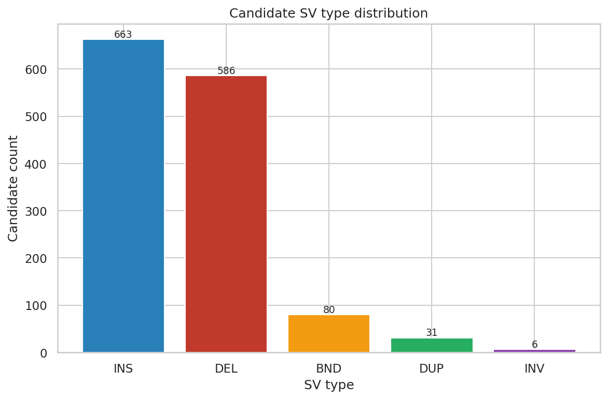
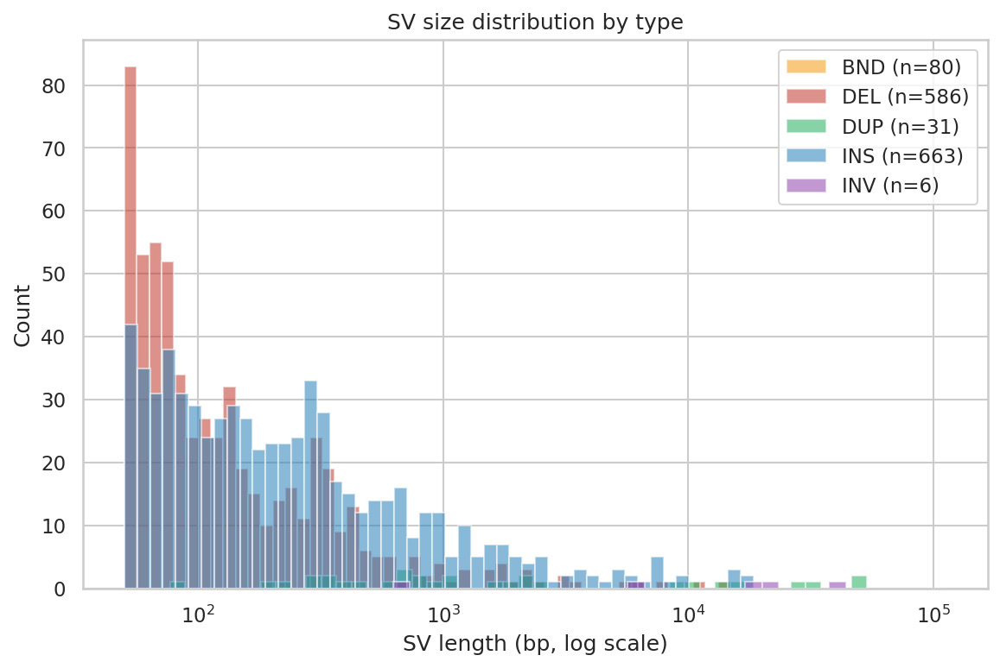
</p>

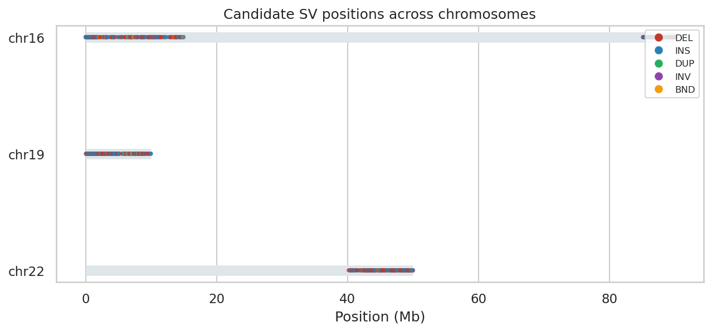

### Stage A: candidate validity (primary)

| Method | Precision | Recall | F1 | Precision 95% CI | Macro-F1 |
|---|---|---|---|---|---|
| Sniffles2 | 0.826 | 0.644 | 0.724 | 0.779–0.880 | 0.575 |
| cuteSV | 0.687 | 0.673 | 0.680 | 0.637–0.747 | 0.356 |
| Union (either caller) | 0.683 | 0.683 | 0.683 | 0.633–0.741 | 0.342 |
| Intersection (both callers) | 0.836 | 0.633 | 0.721 | 0.789–0.888 | 0.580 |
| **Random Forest** | **0.874** | 0.619 | **0.725** | 0.831–0.920 | 0.609 |
| **XGBoost** | **0.920** | 0.569 | 0.703 | 0.879–0.958 | 0.615 |

Confusion at the RF threshold (0.39): **174** true positives, **25** false positives, **18**
real SVs rejected, **64** artefacts removed, plus the 89 real SVs no caller proposed. Accuracy
on the 281 test candidates is 84.7%. Average precision is 0.656 (RF) and 0.654 (XGBoost),
with Brier scores of 0.103 and 0.108.

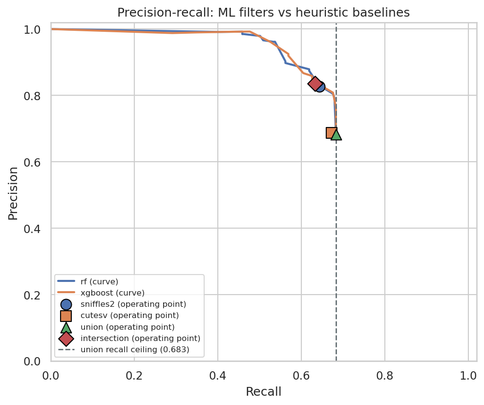

**Matched comparison.** At the intersection baseline's recall of 0.633:

| Model | Precision at matched recall | Gain over intersection |
|---|---|---|
| Random Forest | 0.840 | +0.47 pp |
| XGBoost | 0.840 | +0.39 pp |

The precision claim is supported, but the margin is small. At their default thresholds both
models trade recall for precision, so F1 barely moves.

**Model comparison.** Paired-bootstrap mean F1 difference (RF − XGBoost) is +0.015, 95% CI
[−0.012, +0.045]. There is no significant difference between the models.

<p>
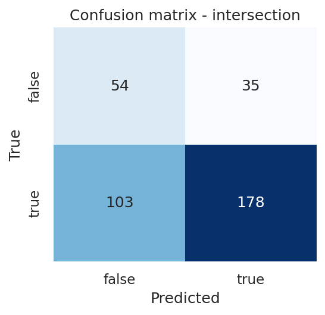
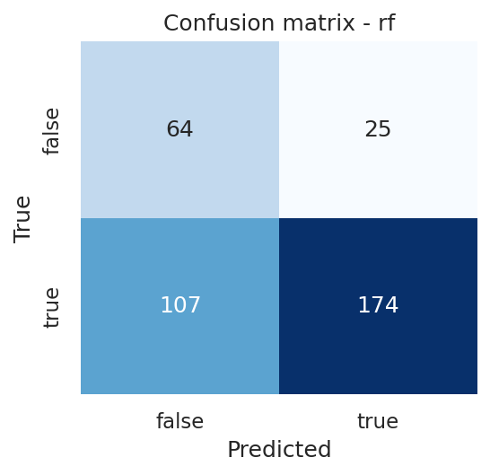
</p>

### Stratified results and the region claim

Precision and recall within each stratum's candidates:

| Stratum | n | Real | Intersection P / R | RF P / R | XGBoost P / R |
|---|---|---|---|---|---|
| Tandem-repeat overlap ≤ 10% | 57 | 23 | 0.957 / 0.957 | 1.000 / 1.000 | 0.955 / 0.913 |
| Tandem-repeat overlap ≥ 50% | 211 | 156 | 0.808 / 0.917 | 0.847 / 0.885 | 0.906 / 0.808 |
| Size 50–100 bp | 115 | 67 | 0.868 / 0.881 | 0.894 / 0.881 | 0.949 / 0.836 |
| Size 100–1,000 bp | 153 | 115 | 0.809 / 0.957 | 0.855 / 0.922 | 0.906 / 0.835 |
| DEL | 149 | 85 | 0.860 / 0.941 | 0.872 / 0.882 | 0.947 / 0.847 |
| INS | 132 | 107 | 0.817 / 0.916 | 0.876 / 0.925 | 0.898 / 0.822 |
| No segmental duplication | 258 | 181 | 0.859 / 0.939 | 0.888 / 0.923 | 0.928 / 0.851 |

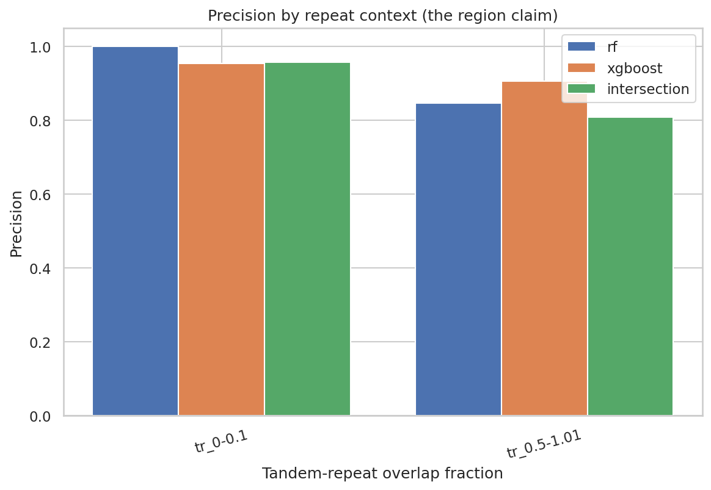

**Region claim: not supported for the headline model.** RF's precision gain over the
intersection is +0.044 in low-repeat candidates and +0.039 in high-repeat candidates, so the
gain does not concentrate in repetitive regions. XGBoost shows the opposite pattern (−0.002 vs
+0.099), so the evidence is mixed rather than absent. Note also that GIAB's confident regions
exclude many of the hardest loci, so "high repeat" here means the most repetitive regions that
have truth, not the most repetitive regions in the genome.

### Ablation: does the model need the callers' own evidence?

| Features | RF precision / recall | XGBoost precision / recall | RF validation F1 |
|---|---|---|---|
| All (B+A+C+V, 33) | 0.874 / 0.619 | 0.920 / 0.569 | 0.844 |
| Independent only (B+A, 23) | 0.792 / 0.598 | 0.810 / 0.605 | 0.694 |
| *Intersection baseline* | *0.836 / 0.633* | | |

With only read and annotation evidence, both models fall **below** the both-callers baseline.
Most of the gain comes from the caller-reported features, so the model mostly recalibrates
the callers' own confidence rather than contributing independent evidence.

### Explainability (SHAP)

- **Random Forest top features:** `cutesv_support`, `caller_qual`, `sniffles_support`,
  `svlen_disagreement`, `bp_offset_between_callers`, followed by the missingness flags that
  encode "only one caller called it", then `filter_pass` and `n_callers`.
- **XGBoost** relies on the same caller features but puts more weight on read evidence
  (`homopolymer_len_at_bp`, `dp_flank_ratio`, `strand_balance`, `support_ratio`).
- **The `caller_qual` dependence plot shows a sharp step.** Quality below about 40 pushes
  strongly toward artefact, above about 50 toward real, so the model has largely rediscovered
  the callers' own quality cutoff.
- **High tandem-repeat overlap nudges scores toward artefact.**

<p>
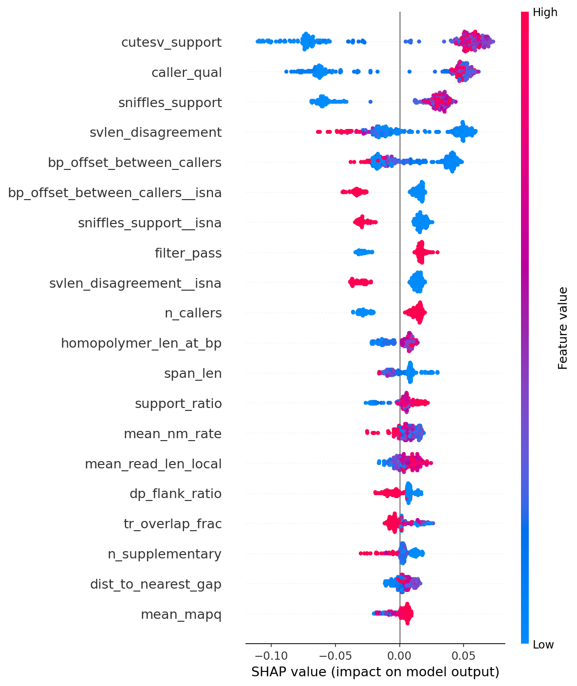
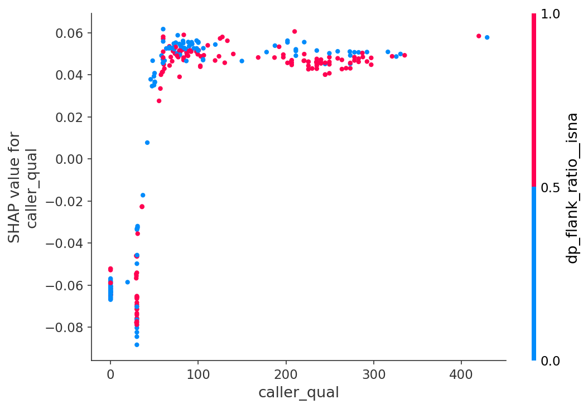
</p>

### Stage B: DEL vs INS (secondary, benchmarked)

Both models reach precision, recall and macro-F1 of **1.000** on 192 test candidates (85 DEL,
107 INS), with both feature sets and with the caller's declared type withheld. The task is
close to trivial at this scale: structurally undefined features separate the classes almost by
themselves (an insertion has no reference span, so its depth ratio is missing). Treat this as a
sanity check rather than a finding. Caller baselines are not reported for Stage B, because
"did a caller call it" is not a type prediction.

### Stage C: five-class type (exploratory, not benchmarked)

| Class | Precision | Recall | F1 | Support |
|---|---|---|---|---|
| INS | 1.000 | 1.000 | 1.000 | 132 |
| DEL | 0.970 | 1.000 | 0.985 | 98 |
| DUP | – | – | 0.000 | 0 |
| INV | – | – | 0.000 | 0 |
| TRA | 0.000 | 0.000 | 0.000 | 3 |

RF macro-F1 **0.397** over 233 candidates, measured against **caller-consensus pseudo-labels,
not GIAB truth**. The test windows contain no DUP or INV pseudo-labels, and all 3 TRA were
missed. These numbers measure agreement with the callers, not accuracy.

### Error analysis

The benchmark sampled **25 false positives** and **18 false negatives** from the test windows
for curation (`benchmark/stageA_false_positives.tsv`, `stageA_false_negatives.tsv`):

| | All in tandem repeats | In segmental duplications | Single-caller |
|---|---|---|---|
| False positives (25) | 25 | 4 | 2 |
| False negatives (18) | 18 | 4 | 7 |

The highest-scoring false positives score 0.73–1.00, were found by both callers, and lie
entirely inside tandem repeats. Each is either a genuine model error, a representation
difference, or a gap in the draft v5.0q benchmark. **Manual IGV curation to tell these apart
has not been done yet.**

### Other samples

HG002 HiFi (244 candidates; 214 called by both callers) and HG005 ONT (165 candidates) ran
through QC, alignment, calling, merging and feature extraction. A cross-platform evaluation of
the ONT-trained model on HiFi has not been reported yet.

### Feature sanity checks

The feature sanity gate ran on all three samples:

- **Depth direction holds:** the median `dp_flank_ratio` is lower for deletions than for
  duplications (HG002 ONT: 0.995 vs 1.233). The deletion median sits close to 1.0, so depth is
  a weak signal for these mostly small, often heterozygous deletions.
- **Expected flags:** `dp_flank_ratio` is missing for about 55% of candidates because
  insertions have no reference span. MAPQ features are near-constant in these
  high-mappability windows, and `chrom_class` is constant because every pilot window is
  autosomal.

---

## Outputs produced

The pipeline writes to `results/` in the configured work directory (`~/svml-work/results` for
the executed run). These files are git-ignored and regenerated by the pipeline; the figures used
in this README are copied into [docs/figures/](docs/figures/).

| Output | Path | Contents |
|---|---|---|
| **Scored VCF** | `final/HG002_ONT.svml.vcf.gz` (+ `.tbi`) | 1,495 records. The 1,366 candidates that passed size/edge filters carry `SVML_SCORE`, `SVML_TYPE` and `SVML_LABEL_STATUS`; low scorers get `FILTER=SVML_LOWCONF` and are kept, not deleted |
| **Report** | `report/report.html`, `report/report.pdf` | 20-section report, 32 pages as PDF |
| Summary | `report/summary.json` | Every metric in machine-readable form |
| Provenance | `report/run_metadata.json` | Tool/package versions, config digest, seed, regions, split map |
| Feature dictionary | `report/feature_dictionary_generated.md` | Generated from the registry |
| **Trained models** | `models/stage{A,B,C}_{model}_{ablation}.pkl` + `.json` | 10 models with encoders and metadata |
| Benchmark | `benchmark/stage{A,B,C}_metrics.json`, `*_ablation_metrics.json` | Baselines, matched comparison, PR curves, strata, CIs |
| Error analysis | `benchmark/stageA_error_analysis.json`, `stageA_false_{positives,negatives}.tsv` | Sampled errors for IGV curation |
| SHAP | `shap/stageA_*/` | Summary, bar, beeswarm and dependence plots, JSON summaries |
| Dataset | `ml/dataset.parquet`, `ml/splits_*.json` | Labelled modelling table and split assignments |
| Labels | `labels/HG002_ONT.labelled.parquet`, `*.gate_summary.json`, `*.truvari/` | Per-candidate labels and gate counts |
| Features | `features/{sample}.parquet` | 33-feature matrices for all three samples |
| Candidates | `candidates/{sample}.merged.vcf(.gz)`, `*.merge_summary.json` | Merged Sniffles2 + cuteSV calls |
| Raw calls | `sv/{sample}.{sniffles,cutesv}.vcf.gz`, `*.header_inspection.txt` | Normalised caller output and inspected INFO fields |
| Alignments | `align/{sample}.sorted.bam`, `*.align_stats.json` | Sorted, indexed BAMs (3.6 GB, almost all disk use) |
| QC | `qc/{sample}/` | NanoPlot output and parsed metrics |
| Exit checks | `checks/` | Contig naming, feature sanity (per sample), label and split-leakage checks |

In the scored VCF, the 1,366 scored records break down as 746 `PASS`, 88 `SVML_LOWCONF`, 18
caller-filtered (`q5`) only, and 514 failed by both the caller filter and the model. Scores on
chr16 and chr19 are in-sample or validation predictions; only chr22 scores are held-out.

---

## Demo site

[site/index.html](site/index.html) is an interactive demo of the Stage A Random Forest on the
281 held-out chr22 candidates:

- **Inspect any candidate:** locus view with each caller's read support, the model's
  probability against the threshold, the GIAB label, the SHAP evidence that moved the score,
  and the full evidence table.
- **Filter** by kept, rejected or mistakes, and by DEL/INS.
- **Move the threshold** and watch precision, recall, F1 and the confusion counts update on
  the precision-recall chart beside the baselines and the recall ceiling.

It is a single self-contained file: it opens from disk with no server or internet and can be
hosted as-is (for example with GitHub Pages from `/site`). Regenerate it after a pipeline run:

```bash
python scripts/build_site.py --results ~/svml-work/results
```

---

## Repository layout

```
Snakefile                 orchestrator; `all` + milestone1/2/3 targets
workflow/rules/*.smk      12 stages, 00_references -> 11_report
workflow/envs/*.yaml      per-stage tool lists (documentation; one env is used in practice)
config/                   config.yaml, samples.tsv, references.yaml
src/svml/                 importable, unit-testable package
  io/                     records (pysam-free), vcf, bam, bed
  candidates/             truvari collapse merge + provenance reconciliation
  features/               registry (schema source of truth) + 4 feature groups
  labels/                 confident-region gate + truvari matching
  ml/                     splits, dataset encoding, models, training, calibration
  eval/                   six baselines, metrics, bootstrap, stratification
  explain/                SHAP
  report/                 plots, HTML/PDF assembly
  cli.py                  the subcommands the Snakemake rules call
  _truvari_entry.py       truvari wrapper working around a pysam bcftools crash
scripts/
  setup_wsl.sh            user-space micromamba + svml environment
  run_pipeline.sh         runs a Snakemake target with a per-run log
  build_site.py           builds site/index.html from a finished run
  site_template.html      demo-site layout
site/index.html           the interactive demo
docs/                     architecture, features, ML task, evaluation, execution plan
docs/figures/             result figures shown in this README
tests/                    87 tests
```

Two design rules hold the architecture together:

1. **Feature extraction never reads truth data.** Truth enters only in `labels/` and `eval/`,
   which keeps leakage out.
2. **`features/registry.py` is the single source of truth for the schema.** The feature
   dictionary is generated from it, so code and docs cannot drift.

Several rules are enforced in code: `src/svml/utils/config.py` refuses a config that disables
the confident-region gate, marks Stage C as benchmarked, drops the union/intersection
baselines, lets Stage B see `svtype_called`, uses different match criteria for labelling and
evaluation, or defines a pilot whose windows do not reach all three splits.
`tests/test_config.py` covers each refusal.

---

## Running the pipeline

### Prerequisites

**Windows users need WSL2.** Minimap2, SAMtools, Sniffles2, cuteSV, bcftools and truvari
have no native Windows builds.

```bash
wsl --install -d Ubuntu          # from PowerShell, once
```

WSL2 needs about 12 GB of memory for whole-genome minimap2 indexing. Set `memory=12GB` in
`%UserProfile%\.wslconfig` and run `wsl --shutdown`. Keep the work directory
(`project.workdir` in `config/config.yaml`) inside the WSL filesystem: I/O on `/mnt/d/...` is
slow enough to dominate alignment and depth queries.

### Setup and run

Inside WSL, from the repo root:

```bash
bash scripts/setup_wsl.sh               # once: micromamba + svml env + environment check
bash scripts/run_pipeline.sh            # whole pipeline; logs under ~/svml-work/logs/
```

Or run the milestones separately:

```bash
snakemake --cores 4 milestone1    # FASTQ -> QC -> BAM -> Sniffles2 + cuteSV -> candidates
snakemake --cores 4 milestone2    # candidates -> feature matrix
snakemake --cores 4 milestone3    # features -> labels -> models -> benchmark
```

The truth filenames and checksums in `config/references.yaml` and the source URLs in
`config/samples.tsv` are filled in, so a fresh run needs no config changes. The pilot downloads
about 4 GB.

### Configuration

Everything is driven by three files; no path is hardcoded:

- `config/config.yaml`: regions and splits, tool flags, feature windows, the ML task,
  evaluation settings, seeds
- `config/samples.tsv`: sample manifest with platform, preset, role and source URL
- `config/references.yaml`: genome, annotation and truth assets with URLs and checksums

### Tests

```bash
python -m pytest tests/ -q
```

87 tests cover config validation, feature maths, the confident-region gate, split leakage,
training and multiclass decoding, the evaluation guards, the report and the truvari wrapper.
They run on Windows too; tests needing pysam, XGBoost or bcftools skip when those are missing.

---

## Issues found by running on real data

Running against the real tools surfaced 19 deviations from the original plan, each recorded
with its evidence in
[docs/06_execution_plan.md](docs/06_execution_plan.md#deviations-found-by-running-against-real-tools-and-data).
The ones that change what a number means:

| # | Change | Why |
|---|---|---|
| D1 | SURVIVOR → `truvari collapse` for merging | SURVIVOR emits symbolic alleles that truvari then filters out, which would have produced zero labels |
| D5 | Single-chromosome pilot → windows on chr16/19/22 | A chromosome-grouped split needs train, validation and test chromosomes |
| D6 | Recall over candidates → recall over truth | Otherwise the union's recall ceiling always reads 1.0 |
| D10 | `pctseq 0.7` → `0` | Sequence similarity drops symbolic-allele calls before matching |
| D11 | truvari routed through `svml._truvari_entry` | pysam's bundled bcftools crashes under WSL2 when truvari finalises output |
| D16 | Multiclass decoding fixed | Classes absent from training shifted predicted labels and halved Stage C macro-F1 |
| D17 | Stage C trains Random Forest only | XGBoost cannot train with a class missing from the training fold |
| D19 | Final VCF writer rewritten | `header.copy()` + `translate()` silently produced an empty VCF |

The others cover environment and tooling: memory limits, minimap2 flags, NanoPlot bugs,
Snakemake's conda reporter, CRLF line endings and report wiring.

---

## Limitations

- **No DUP / INV / TRA ground truth exists in GIAB.** Those classes are pseudo-labelled and
  not benchmarked.
- **One labelled sample (HG002).** Generalisation can be tested across platforms, not across
  individuals.
- **Region-scoped pilot.** SV-rich sub-telomeric windows, 281 truth SVs in the test split:
  confidence intervals are wide and the numbers are not genome-representative.
- **Small, caller-dependent gain.** The precision gain over the intersection baseline is
  under half a percentage point at matched recall, and independent evidence alone does not
  beat that baseline.
- **Confident regions exclude the hardest loci,** so the project measures a repeat-context
  gradient but cannot benchmark the most repetitive parts of the genome.
- **Recall is capped by the callers.** The ML layer is a filter and cannot discover SVs
  neither caller proposed (89 of 281 in the test windows).
- **`v5.0q` is a draft benchmark,** and putative errors require manual curation, which has
  not been done.
- **No `--refine`.** Some representation differences between caller and truth alleles count
  as errors.

This is a research-grade prototype. It is **not** clinically validated and makes no medical
claims.

---

## Outstanding work

1. **Manual IGV curation** of the 25 sampled false positives and 18 false negatives.
2. **A worked single-SV trace** in the report, from raw reads through prediction to
   explanation (the demo site already shows most of this interactively).
3. **Reproducibility check:** a fresh clone, a new environment, a full rerun, and
   confirmation that deleting a mid-pipeline output reruns only downstream rules.
4. **Tier-2 decision:** record measured runtime and storage, then scale to full chromosomes
   or document why not.
5. **Cross-platform evaluation** of the ONT-trained model on the HiFi candidates.
6. **Checksums** for the reference genome and the four UCSC tracks (`md5: TODO` in
   `config/references.yaml`).

---

## Documentation

| Document | Contents |
|---|---|
| [00_architecture_evaluation.md](docs/00_architecture_evaluation.md) | Review of the proposed architecture; 13 findings with fixes |
| [01_system_architecture.md](docs/01_system_architecture.md) | Revised system, data-flow and ML-flow diagrams |
| [02_repository_architecture.md](docs/02_repository_architecture.md) | Directory layout and conventions |
| [03_feature_dictionary.md](docs/03_feature_dictionary.md) | All 33 features: definition, calculation, missing-value rule, biological meaning |
| [04_ml_task_definition.md](docs/04_ml_task_definition.md) | Task choice, labelling rules, splits, leakage control |
| [05_evaluation_protocol.md](docs/05_evaluation_protocol.md) | Six baselines, PR curves, stratification, error analysis |
| [06_execution_plan.md](docs/06_execution_plan.md) | Phases 0–13 with exit tests, execution status, and the 19 deviations |

---

## Course alignment

| CO | Evidence |
|---|---|
| CO1 | FASTQ, SAM/BAM, VCF, BED and feature matrices handled end to end |
| CO2 | Minimap2, Sniffles2, cuteSV, SAMtools, bcftools, NanoPlot, Truvari |
| CO3 | Long-read alignment and SV signature interpretation (split reads, depth, clipping, breakpoint context) |
| CO4 | Snakemake reproducible pipeline with provenance capture and exit tests per phase |

## References

Sedlazeck et al. 2018 (Nature Methods) · Heller & Vingron 2019 (Bioinformatics) ·
Jiang et al. 2020 (Genome Biology) · Zook et al. 2020 (Nature Biotechnology) ·
Lin et al. 2022 (Nature Methods) · Popic et al. 2023 (Nature Methods) ·
Smolka et al. 2024 (Nature Biotechnology) · Li 2018 (Bioinformatics)
